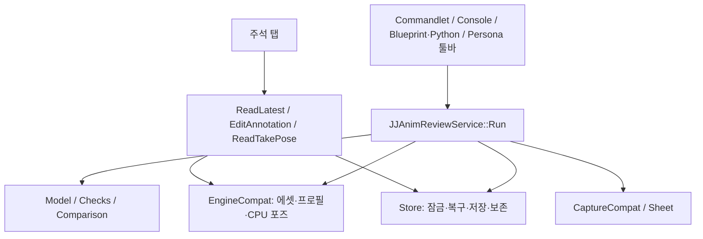

# JJAnimReviewKit 구현과 구조

UE 5.8 / Win64 Editor 전용 AnimSequence 리뷰 플러그인. 독립 repo용 기술 안내이며 2026-11-08의 현재 소스를 기준으로 한다. [사용자 안내서](USER_GUIDE.ko.md), [AI 연동](../AI_USAGE.md), [엔진 호환 가정](../PORTING.md)을 참고한다.

R0~R6의 검사·시트·주석·그룹·포즈 지시·비교를 구현했다. R6-fix2는 코드로 만든 임시 반투명 머티리얼과 PoseableMesh 고스트를 사용하고, 실패할 때 필터된 선 고스트로 대체한다. 실행 검증 범위는 끝의 "유지보수와 검증 경계"에 적는다.

## 모듈과 진입점

모듈은 `JJAnimReviewKitEditor` 하나다. Public 의존은 Core·CoreUObject·Engine, Private 의존은 AnimationBlueprintLibrary·Json·JsonUtilities·UnrealEd·AnimationEditor·Persona·Slate·SlateCore·RenderCore·RHI·Projects·DesktopPlatform이다. Ter 모듈에 의존하지 않는다.

| 진입점 | 동작 |
|---|---|
| `UJJAnimReviewCommandlet::Main` | Asset·Profile·Output·Sheet 인자 해석, 서비스 종료 코드 전달 |
| `JJAnimReview.Create` / `JJAnimReview.Sheet` | 콘솔 인자를 요청으로 변환 |
| `UJJAnimReviewLibrary` | Blueprint/Python용 동기 wrapper와 out 결과 |
| Persona 툴바 | 현재 AnimSequence로 기본 출력·프로필 없는 capture 요청 |
| 주석 탭 | 최신 기본 출력 리뷰 읽기, 변경 검증, 주석 편집·고스트 표시 |

## 파일별 책임

다음 경로는 `Source/JJAnimReviewKitEditor/` 기준이다.

| 파일 | 책임 |
|---|---|
| `Public/JJAnimReviewTypes.h` | 리뷰·포즈·검사·주석의 reflected DTO |
| `Public/JJAnimReviewProfile.h` | Skeleton과 본·접지·소켓·검사 임계값 DataAsset |
| `Public/JJAnimReviewCaptureSettings.h` | 프레임·각도·셀·정면 방향 설정 |
| `Private/JJAnimReviewService.*` | 요청 검증과 분석·저장·캡처 순서 |
| `Private/JJAnimReviewModel.*` | 내용 해시·테이크 선택·직렬화·Markdown 요약 |
| `Private/JJAnimReviewChecks.*` | 포즈 DTO 기반 수치 검사 |
| `Private/JJAnimReviewComparison.*` | 시간 대응 포즈 비교와 차이 구간 |
| `Private/JJAnimReviewEditing.*` | 주석 변경·로컬 포즈 지시 후보 계산과 필터 후 설명문 생성 |
| `Private/JJAnimReviewStore.*` | 출력 경계·잠금·transaction·복구·보존 |
| `Private/JJAnimReviewSheet.*` | 렌더 없는 프레임 선택·레이아웃 계산 |
| `Private/*Compat.cpp` | 에셋 샘플·Persona·주석 위젯·렌더 등 엔진 API 연결 |

## 상태 소유와 실행 계약

Entry는 공통 `Run`이며 UObject 작업을 game thread에서 동기 수행한다. 서비스 요청이 파일 저장소 잠금의 수명을 가진다. AnimSequence와 프로필은 입력이며 수정·저장하지 않는다. 렌더용 preview scene과 컴포넌트는 캡처 경로가, 주석 탭의 표시 자원은 탭이 관리한다.

영속 상태의 원본은 take의 `review.json`이다. `review.md`는 파생 요약이고 `pose.json`은 전체 포즈다. 서비스 실행에는 상시 Tick이 없지만 GUI 주석·고스트 표시 중에는 preview scene PostTick callback을 사용한다. 탭 종료·표시 정리 시 연결을 해제한다.

## 리뷰 생성 흐름

1. 경로를 정규화하고 Output이 `Saved/JJAnimReview/` 내부인지 검사한다.
2. 에셋별 저장소 잠금을 확보하고 transaction 복구 및 기존 take 읽기를 수행한다.
3. AnimSequence·선택 프로필을 로드한다. 프로필이 없으면 본 이름으로 추정한다.
4. 소스 프레임 시각에서 CPU 포즈를 샘플링하고 `pose_md5_v2` 내용 ID를 계산한다.
5. 최신 내용이 같으면 최신 take 갱신, 달라지면 새 take 생성과 열린 주석 이월을 선택한다.
6. 수치 검사를 실행하고 이전 v2 take가 있으면 포즈 차이도 계산한다.
7. 리뷰·포즈를 저장한다. capture 요청이면 sheet 생성 후 이미지 경로 또는 경고를 반영해 다시 저장한다.
8. 보존 정책을 적용하고 경로·경고·종료 코드를 반환한다.

0은 검사 실패 없음, 1은 검사 실패 있음, 2는 경로·로드·잠금·저장 등의 실행 오류다. 경고만 있거나 캡처가 생략돼도 0일 수 있다.

## 포즈·검사·비교 정책

포즈는 source-frame 기반이며 component transform과 Raw root의 0초 대비 상대 root motion을 사용한다. JSON은 Euler 기반 DTO/schema v2를 사용하지만 내용 ID는 반올림한 quaternion 부호를 정규화하는 `pose_md5_v2` 정책이다. schema 번호와 해시 버전은 별개다.

검사는 foot_sliding·penetration·pop·joint_limits·root_discontinuity·loop_mismatch·socket_drift 일곱 종류다. 앞 10000샘플 제한과 근사/추정 경고를 결과에 남긴다. 내용 식별과 루프 끝점은 전체 포즈를 사용한다. PhysicsAsset joint limit은 swing/twist 근사이므로 물리 시뮬레이션의 완전 재현은 아니다. Limited 축만 검사하고, 결과는 (자식 본, 축)별 마지막 결과 인덱스를 기억해 같은 축의 연속 프레임만 한 구간으로 합친다(축이 번갈아 나와도 프레임마다 쪼개지지 않음). 다른 검사는 직전 결과와만 병합한다.

비교는 시간 대응 component-space 포즈를 사용하고 root motion도 포함한다. 작은 차이 0.1cm / 0.5deg는 무시하며 요약은 차이가 큰 본 상위 10개와 프레임 구간을 전달한다. 최대 이동과 최대 회전이 같은 시점이라는 보장은 없다. R5 이전 폴더와 0 채움 take는 열거하지 않으며 보존·이전·삭제하지 않는다. 새 경로에서 이전 schema 파일을 만나면 미지원 오류다.

## GUI 편집과 캡처

Persona extender가 AnimSequence 에디터마다 버튼을 추가한다. 툴바는 프로필 선택 UI를 제공하지 않으므로 명시 프로필은 콘솔·commandlet·library를 사용한다.

주석 편집 전 최신 content ID와 현재 샘플의 ID를 대조한다. 오래된 탭·변경된 에셋은 오류로 거부해 다른 포즈 버전에 주석을 붙이지 않는다. 추가 주석은 현재 프레임·선택 본을 사용하며 포즈 지시는 원본 샘플과 평가된 preview transform의 로컬 차이 후보를 만들고, GetBoneControllers의 직접 수정 본 이름으로 걸러 구조 데이터와 설명문을 함께 만든다. 루트 직접 수정 시 원본 비교 기준의 루트 잠금을 맞춰 루트 모션 모드 차이를 제외한다(A30/A32). preview 수정 자체를 원본에 저장하거나 자동 초기화하지 않는다. 본 수정 초기화 버튼은 Persona와 같은 트랜잭션 안에서 PreviewInstance만 Modify/ResetModifiedBone하며 Ctrl+Z를 지원한다. AnimGraph는 private 의존이다.

주석·고스트 UI는 기본 출력만 읽는다. 주석 ±2f 표시와 자홍색 이전 v2 포즈의 반투명 메시를 preview scene에 그린다. 고스트는 저장 포즈의 시간 보간이며 원본 메시·모프·클로스 시뮬레이션·에디터 상태 전체의 복원은 아니다.

캡처는 별도 preview scene·미리보기 메시·렌더 자원으로 sheet를 생성한다. 프레임 최대 24개, 각도 1–8개, 전체 레이아웃 상한으로 셀 크기를 제한한다. GUI/렌더링 또는 Preview Mesh가 없으면 이유를 남겨 생략한다. 동기 렌더/readback이므로 요청 시 지연이 있을 수 있다.

## 저장·복구·보존

R5는 `<에셋 이름>_<해시6>/take_<양의 정수>` 경로와 review/pose schema v2를 쓴다. 해시는 lowercase object path UTF-8의 MD5 앞 6자리이며 에셋 이름 대소문자는 유지한다. Model의 `ParseTakeName`·`SortTakeNames`·`AssetDirectoryKey`는 순수 함수다. 이전 형식 폴더는 열거하거나 지우지 않는다. 다른 asset 경로가 든 review.json은 복구·쓰기 전에 충돌 오류로 거부한다. 손상된 transaction은 asset을 대조한 `.previous`로만 복구한다.

`JJAnimReviewNotes.*`는 구간 검증, 주석 대상·범례·줄, 템플릿/사용자 그룹 병합, 그룹 JSON, 미참조 이미지 폴더 계산을 맡는다. 모두 합성 본·부모·주석·take 배열만으로 호출할 수 있다. `Frame`은 시작이며 `EndFrame=INDEX_NONE`은 단일 프레임을 뜻한다. 그룹 주석은 GroupName과 Bones 사본을 보존하며 단일 Bone 필드도 유지한다. 같은 그룹 이름의 사본이 여러 개면 md 범례는 합집합이고 원본 주석별 사본은 JSON에 남는다.

사용자 그룹은 `JJAnimReviewBoneGroupsCompat`가 `IPluginManager` BaseDir 아래 BoneGroups에서 읽고 명시 저장 때만 디렉터리·파일을 만든다. JSON v1은 skeleton 경로·그룹 이름·쪽·본만 저장한다. 시트 색은 쪽에서, 뷰포트 그룹 색은 고정 팔레트/이름 해시에서 계산하며 파일에는 색을 저장하지 않는다. 기준 본 16개 중 12개 이상이면 코드 내장 마네킹 8그룹을 적용하며 사용자 그룹은 같은 이름을 대체한다. 기본 그룹 삭제는 빈 override로 표현한다. 스테이징 파일을 쓴 뒤 교체하며 손상·경로 충돌은 덮어쓰지 않는다.

이미지는 Store가 잠금 안에서 고유 파일로 `notes/<AnnotationId>/`에 복사한 뒤 review transaction을 저장한다. 실패 시 고아 파일이 남을 수 있으나 다음 정상 정리에서 참조 없는 폴더를 제거한다. 이월·이월 주석 수정은 기존 경로를 유지한다. take 삭제 후 실제 남은 리뷰를 다시 읽어 이미지 참조 합집합을 계산하므로 삭제 실패한 take도 보호한다. 읽기/복구 실패 때 이미지 정리는 생략한다.

뷰포트 선의 Outer는 Persona preview actor다. 탭이 선택·애니메이션·메시 변경 델리게이트를 소유하고 소멸 시 해제한다. 주석/고스트/유효 그룹이 있을 때만 post-tick을 등록한다. 정점 색 칠하기는 LOD별 CPU 가중치와 섹션 본 맵으로 합성하며 본별 색 결과가 바뀔 때만 업로드한다. 토글·그룹 등 입력 변경 시에도 갱신한다. 원래 머티리얼 슬롯은 TStrongObjectPtr로 보호하고, 끄기·대상 없음·탭 종료·애니메이션/메시 변경 때 정점 색 덮어쓰기와 강한 참조를 해제한다. 지원 조건 불충족 시 BonesOfInterest 본 가중치 보기와 색 선으로 대체한다. Persona 자체의 본 가중치·모프 표시에는 양보한다. 메시 교체 뒤에는 새 메시 재질을 보존해 이전 메시 재질을 덮지 않는다. 시트는 열마다 별도 PoseableMesh를 등록해 ShowOnlyComponents로 선택하고 캡처 전 end-of-frame update와 렌더 flush를 보낸 뒤 모든 컴포넌트를 해제한다. 모든 선택 프레임의 합친 범위로 카메라 거리·높이를 고정한다. 그림자를 끄고 카메라 방향 조명·중립 색 보정을 쓰며, 그룹 선은 캡처 후 2D 투영한다. 등록 직후의 GPU 포즈 반영·실제 배경 밝기·토글 복원은 GUI 미확인이다.

저장소는 잠금 아래 읽기·복구·저장·정리를 수행한다. `.transaction`과 `.previous`를 이용해 중간 실패를 복구하며, 복구할 수 없는 손상은 기존 데이터를 빈 리뷰로 덮지 않고 오류로 중단한다.

기본 보존 수는 10이다. 최신 take와 최신 리뷰의 열린 주석이 참조하는 `AuthoredTake`를 보호한다. 이월 사본만 있는 중간 take는 정리할 수 있다. 해결 상태의 원본은 최신 리뷰이며 과거 모든 사본을 동시에 수정하는 정책은 아니다.

`review.md`는 6000 UTF-8 바이트 예산과 항목별 생략 수를 사용한다. 빈 메시지는 구분자 없이 쓰고, skipped가 0이면 그 절을 생략한다. 전체 결과를 요약만으로 복원할 수 없으며 상세 원본은 JSON을 읽어야 한다.

주석 탭은 저장소를 읽기 전용으로 연다. 중단된 transaction을 발견하면 복구하지 않고, 같은 에셋의 리뷰 생성을 다시 실행하라는 오류를 낸다.

## 유지보수와 검증 경계

엔진 연결 변경은 `*Compat`와 `PORTING.md` 가정부터 확인한다. 순수 계산은 Model·Notes·Checks·Comparison·Editing·Sheet에 유지한다. 지원 버전을 늘렸다는 근거 없이 버전 분기나 엔진 Private 헤더를 추가하지 않는다.

자동화 테스트는 `Private/Tests/`에 있다(Claude 작성). R1~R4-fix2 당시 Claude의 21개 headless 통과 기록은 R5 검증이 아니다. R5에서는 테스트를 작성·실행하지 않고 이름 규칙 기대값은 Claude가 갱신한다. R5 빌드·커맨드렛 결과는 shared handoff의 최신 Codex 항목을 따른다. GUI(툴바·주석 탭·고스트)와 실제 시트 렌더는 실행 검증하지 않았다.

## R6 표시 계산과 안전 조건

- `JJAnimReviewNotes`의 `GroupColor`, `UniqueGroupName`, `RestoreDefaultGroups`, `WeightedSegments`, `VisibleNotes`, `BoneColors`, `VertexColor`는 합성 배열·이름·가중치로 호출하는 순수 함수다. 기존 공개 DTO·함수 서명·저장 스키마는 유지한다.
- 이름 충돌은 템플릿과 사용자 목록을 모두 예약해 첫 빈 번호를 붙인다. 기본 복원은 템플릿 이름과 일치하는 빈 사용자 항목만 제거한다. 그룹 드롭다운과 칠하기 토글은 별개 상태다.
- `JJAnimReviewMeshCompat.cpp`는 공개 LOD0 섹션 BoneMap, CPU 잔존 skin weights, 엔진 머티리얼의 읽기 전용 검사를 담당한다(A22~A25). 선 필터는 표시만 바꾸며 pose.json·검사·포즈 지시·비교 수치를 바꾸지 않는다.
- 색 우선순위는 선택 주석 → 열린 주석(그룹 목록 순서, 같은 그룹은 주석 순서) → 선택 그룹 → 전체 그룹이다. 주석은 [시작−2, 끝+2]에서만 보이며 선택 여부는 해결 상태만 무시한다. 정점은 영향 본 색을 가중치 비례로 혼합하고 대상 밖 영향은 회색이다.
- post-tick에서는 현재 프레임의 본 색 결과를 비교한다. 정점 색 합성과 업로드는 결과/표시 입력이 바뀔 때만 한다. 유휴 때 callback 등록이 없다. Persona 객체는 약한 참조이고 저장 머티리얼·선 컴포넌트는 강한 참조다.
- 공개 SetVertexColorOverride_LinearColor/ClearVertexColorOverride를 사용한다. LOD의 정점 수 불일치·CPU 데이터 없음은 생략하고 상태를 쓴다. 정점 칠하기 경로는 머티리얼 사용 플래그 설정·CheckMaterialUsage·에셋 저장을 호출하지 않는다. dirty package 또는 미준비/실패 셰이더는 대체 경로로 내려간다.
- 포즈 지시는 항상 현재 프레임 하나이며 고친 본의 로컬 차이만 보존한다. 미지정 본 로컬 변환은 그대로이고 자식은 FK로 따라온다. 월드 위치 유지 관계와 앞뒤 프레임 연결은 텍스트와 작업 AI 판단이 필요하다.
- **소유·수명(A26~A29):** 모듈이 `TStrongObjectPtr<UMaterial>`로 세션당 하나의 임시 기본 머티리얼을 지연 생성·보유한다. 위젯이 Persona actor Outer의 `UPoseableMeshComponent`와 MID를 각각 강한 참조로 보유한다. 준비 중에는 컴포넌트를 만들지 않고, 컴파일 완료·유효/완전한 셰이더 맵 확인 뒤 모든 슬롯에 MID를 넣어 숨긴 채 등록한다. 저장 포즈를 현재 시각으로 보간하고 컴포넌트 공간→실제 메시 부모 기준 로컬 변환으로 넣어 갱신한 뒤 보인다. 그림자·충돌·선택·컴포넌트 Tick은 꺼져 있다. 끄기·take 변경·탭 종료·애니메이션/메시 변경에서 씬 제거·DestroyComponent 후 MID/컴포넌트 강한 참조와 포즈 버퍼를 놓는다. 모듈 종료는 탭을 먼저 닫고 기본 머티리얼을 놓는다. 별도 Tick·타이머 없이 기존 활성 post-tick에서만 컴파일을 확인하며 게임 스레드에서 기다리지 않는다. 실패는 상태 문구와 D23 선 고스트로 대체한다.
- **확인된 소스 사실/한계:** 기존 엔진 반투명 후보는 쓰지 않으며 사용 플래그 설정은 새 임시 기본 머티리얼에만 한 번 수행한다. `Config/DefaultEngine.ini`는 Substrate를 켠다. R7은 공개 `Substrate::IsHiddenMaterialAssetConversionEnabled()`가 true일 때 legacy 입력을 유지한 채 `ForceRecompileForRendering(Default)`로 비동기 작업을 제출해 전역 렌더 상태 재생성을 피한다. false이면 `PostEditChange`의 변환 뒤 같은 Default 호출로 작업을 제출한다. None 모드와 PostEditChange만으로는 숨긴 고스트의 셰이더 작업이 제출되지 않는다(UT21). 세션당 머티리얼 하나를 위해 네 사용 플래그를 유지한다. 새 Unlit Surface 재질에는 전달할 프로필 데이터나 기존 사용 컴포넌트가 없다(A29). 이 소스 근거는 실제 셰이더 성공·반투명 픽셀·저장 프롬프트 부재를 입증하지 않는다. 콘텐츠 브라우저/피커 노출, 패키지 dirty, 준비 중 화면·GC·해제는 GUI 확인 대상이다. 메시·선 고스트 모두 Notes::GhostBasis(컴포넌트 변환, 적용 루트 모션)를 쓴다(A31). LoopAndReset은 엔진의 0초~현재 추출분과 초기 루트로 보정하고, Ignore·루트 모션 꺼짐은 항등 적용분이며, 물리 본 시뮬레이션이 하나라도 있으면 공개 API로 보수적으로 보정을 생략한다. 엔진의 정확한 ShouldBlendPhysicsBones는 protected이므로 호출하지 않는다(D16). Loop의 이전 주기 누적·바닥 래핑 잔여분은 기준에 남고 경계·역재생·턴테이블·미러·Raw/압축 차이는 한계다. take 포즈 자체는 바꾸지 않는다. 관절 점은 캐시한 손가락·twist 필터를 거쳐 5px 주황색·depth 0으로 그린다.
- **검증 한계:** 머티리얼 속성 조회는 실제 픽셀의 정상 렌더를 입증하지 않는다. 메시 칠하기·GC 이후 복원·교체·밝기는 GUI 확인이 필요하다. R6에서 자동화 테스트는 작성·수정·실행하지 않았다. 실제 빌드 결과는 shared handoff의 R6 항목을 따른다.

- R7 호환 계층 JJAnimReviewPreviewCompat.cpp는 미리보기 수정 본 조회·초기화(A30), 고스트 기준에 넣을 적용 루트 모션(A31), 지시 비교용 루트 잠금(A32)을 담당한다. 새 순수 함수 Notes::GhostBasis와 Notes::FilterPoseInstructions는 에셋·에디터·렌더 없이 합성 입력으로 호출할 수 있다. 기존 Notes 함수 시그니처와 저장 스키마는 유지한다.
