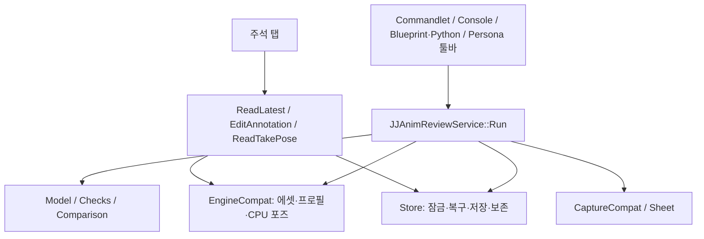

# JJAnimReviewKit 구현과 구조

UE 5.8 / Win64 Editor 전용 AnimSequence 리뷰 플러그인. 독립 repo용 기술 안내이며 2026-11-07의 현재 소스를 기준으로 한다. [사용자 안내서](USER_GUIDE.ko.md), [AI 연동](../AI_USAGE.md), [엔진 호환 가정](../PORTING.md)을 참고한다.

R0~R4(검사, 시트, 주석·포즈 지시, 테이크 비교·고스트)와 리뷰 수정이 구현돼 있다. 실행 검증 범위는 끝의 "유지보수와 검증 경계"에 적는다.

## 모듈과 진입점

모듈은 `JJAnimReviewKitEditor` 하나다. Public 의존은 Core·CoreUObject·Engine, Private 의존은 AnimationBlueprintLibrary·Json·JsonUtilities·UnrealEd·AnimationEditor·Persona·Slate·SlateCore·RenderCore·RHI다. Ter 모듈에 의존하지 않는다.

| 진입점 | 동작 |
|---|---|
| `UJJAnimReviewCommandlet::Main` | Asset·Profile·Output·Sheet 인자 해석, 서비스 종료 코드 전달 |
| `JJAnimReview.Create` / `JJAnimReview.Sheet` | 콘솔 인자를 요청으로 변환 |
| `UJJAnimReviewLibrary` | Blueprint/Python용 동기 wrapper와 out 결과 |
| Persona 툴바 | 현재 AnimSequence로 기본 출력·프로필 없는 capture 요청 |
| 주석 탭 | 최신 기본 출력 리뷰 읽기, 변경 검증, 주석 편집·고스트 표시 |

## 파일별 책임

다음 경로는 `Source/JJAnimReviewKitEditor/` 기준이다.

| 파일 | 책임 |
|---|---|
| `Public/JJAnimReviewTypes.h` | 리뷰·포즈·검사·주석의 reflected DTO |
| `Public/JJAnimReviewProfile.h` | Skeleton과 본·접지·소켓·검사 임계값 DataAsset |
| `Public/JJAnimReviewCaptureSettings.h` | 프레임·각도·셀·정면 방향 설정 |
| `Private/JJAnimReviewService.*` | 요청 검증과 분석·저장·캡처 순서 |
| `Private/JJAnimReviewModel.*` | 내용 해시·테이크 선택·직렬화·Markdown 요약 |
| `Private/JJAnimReviewChecks.*` | 포즈 DTO 기반 수치 검사 |
| `Private/JJAnimReviewComparison.*` | 시간 대응 포즈 비교와 차이 구간 |
| `Private/JJAnimReviewEditing.*` | 주석 변경·로컬 포즈 지시 계산 |
| `Private/JJAnimReviewStore.*` | 출력 경계·잠금·transaction·복구·보존 |
| `Private/JJAnimReviewSheet.*` | 렌더 없는 프레임 선택·레이아웃 계산 |
| `Private/*Compat.cpp` | 에셋 샘플·Persona·주석 위젯·렌더 등 엔진 API 연결 |

## 상태 소유와 실행 계약

Entry는 공통 `Run`이며 UObject 작업을 game thread에서 동기 수행한다. 서비스 요청이 파일 저장소 잠금의 수명을 가진다. AnimSequence와 프로필은 입력이며 수정·저장하지 않는다. 렌더용 preview scene과 컴포넌트는 캡처 경로가, 주석 탭의 표시 자원은 탭이 관리한다.

영속 상태의 원본은 take의 `review.json`이다. `review.md`는 파생 요약이고 `pose.json`은 전체 포즈다. 서비스 실행에는 상시 Tick이 없지만 GUI 주석·고스트 표시 중에는 preview scene PostTick callback을 사용한다. 탭 종료·표시 정리 시 연결을 해제한다.

## 리뷰 생성 흐름

1. 경로를 정규화하고 Output이 `Saved/JJAnimReview/` 내부인지 검사한다.
2. 에셋별 저장소 잠금을 확보하고 transaction 복구 및 기존 take 읽기를 수행한다.
3. AnimSequence·선택 프로필을 로드한다. 프로필이 없으면 본 이름으로 추정한다.
4. 소스 프레임 시각에서 CPU 포즈를 샘플링하고 `pose_md5_v2` 내용 ID를 계산한다.
5. 최신 내용이 같으면 최신 take 갱신, 달라지면 새 take 생성과 열린 주석 이월을 선택한다.
6. 수치 검사를 실행하고 이전 v2 take가 있으면 포즈 차이도 계산한다.
7. 리뷰·포즈를 저장한다. capture 요청이면 sheet 생성 후 이미지 경로 또는 경고를 반영해 다시 저장한다.
8. 보존 정책을 적용하고 경로·경고·종료 코드를 반환한다.

0은 검사 실패 없음, 1은 검사 실패 있음, 2는 경로·로드·잠금·저장 등의 실행 오류다. 경고만 있거나 캡처가 생략돼도 0일 수 있다.

## 포즈·검사·비교 정책

포즈는 source-frame 기반이며 component transform과 Raw root의 0초 대비 상대 root motion을 사용한다. JSON은 Euler 기반 DTO/schema v1을 유지하지만 내용 ID는 반올림한 quaternion 부호를 정규화하는 `pose_md5_v2` 정책이다. schema 번호와 해시 버전은 별개다.

검사는 foot_sliding·penetration·pop·joint_limits·root_discontinuity·loop_mismatch·socket_drift 일곱 종류다. 앞 10000샘플 제한과 근사/추정 경고를 결과에 남긴다. 내용 식별과 루프 끝점은 전체 포즈를 사용한다. PhysicsAsset joint limit은 swing/twist 근사이므로 물리 시뮬레이션의 완전 재현은 아니다. Limited 축만 검사하고, 결과는 (자식 본, 축)별 마지막 결과 인덱스를 기억해 같은 축의 연속 프레임만 한 구간으로 합친다(축이 번갈아 나와도 프레임마다 쪼개지지 않음). 다른 검사는 직전 결과와만 병합한다.

비교는 시간 대응 component-space 포즈를 사용하고 root motion도 포함한다. 작은 차이 0.1cm / 0.5deg는 무시하며 요약은 차이가 큰 본 상위 10개와 프레임 구간을 전달한다. 최대 이동과 최대 회전이 같은 시점이라는 보장은 없다. v1 메타데이터는 보존하지만 v1 pose 비교·고스트는 건너뛴다.

## GUI 편집과 캡처

Persona extender가 AnimSequence 에디터마다 버튼을 추가한다. 툴바는 프로필 선택 UI를 제공하지 않으므로 명시 프로필은 콘솔·commandlet·library를 사용한다.

주석 편집 전 최신 content ID와 현재 샘플의 ID를 대조한다. 오래된 탭·변경된 에셋은 오류로 거부해 다른 포즈 버전에 주석을 붙이지 않는다. 추가 주석은 현재 프레임·선택 본을 사용하며 포즈 지시는 원본 샘플과 평가된 preview transform의 로컬 차이로 만든다. preview 수정 자체를 원본에 저장하거나 자동 초기화하지 않는다.

주석·고스트 UI는 기본 출력만 읽는다. 주석 ±2f 표시와 자홍색 이전 v2 skeleton 선을 preview scene에 그린다. 고스트는 시간 대응 뼈대 비교이며 원본 메시·에디터 상태 전체의 복원은 아니다.

캡처는 별도 preview scene·미리보기 메시·렌더 자원으로 sheet를 생성한다. 프레임 최대 24개, 각도 1–8개, 전체 레이아웃 상한으로 셀 크기를 제한한다. GUI/렌더링 또는 Preview Mesh가 없으면 이유를 남겨 생략한다. 동기 렌더/readback이므로 요청 시 지연이 있을 수 있다.

## 저장·복구·보존

저장소는 잠금 아래 읽기·복구·저장·정리를 수행한다. `.transaction`과 `.previous`를 이용해 중간 실패를 복구하며, 복구할 수 없는 손상은 기존 데이터를 빈 리뷰로 덮지 않고 오류로 중단한다.

기본 보존 수는 10이다. 최신 take와 최신 리뷰의 열린 주석이 참조하는 `AuthoredTake`를 보호한다. 이월 사본만 있는 중간 take는 정리할 수 있다. 해결 상태의 원본은 최신 리뷰이며 과거 모든 사본을 동시에 수정하는 정책은 아니다.

`review.md`는 6000 UTF-8 바이트 예산과 항목별 생략 수를 사용한다. 빈 메시지는 구분자 없이 쓰고, skipped가 0이면 그 절을 생략한다. 전체 결과를 요약만으로 복원할 수 없으며 상세 원본은 JSON을 읽어야 한다.

주석 탭은 저장소를 읽기 전용으로 연다. 중단된 transaction을 발견하면 복구하지 않고, 같은 에셋의 리뷰 생성을 다시 실행하라는 오류를 낸다.

## 유지보수와 검증 경계

엔진 연결 변경은 `*Compat`와 `PORTING.md` 가정부터 확인한다. 순수 계산은 Model·Checks·Comparison·Editing·Sheet에 유지한다. 지원 버전을 늘렸다는 근거 없이 버전 분기나 엔진 Private 헤더를 추가하지 않는다.

자동화 테스트는 `Private/Tests/`에 있다(Claude 작성). 2026-11-07 기준 21개가 headless로 통과했고 에디터 타깃 빌드가 성공했다. 커맨드렛은 Ter 에셋 하나로 실행했다. GUI(툴바·주석 탭·고스트)와 실제 시트 렌더는 실행 검증하지 않았다.
